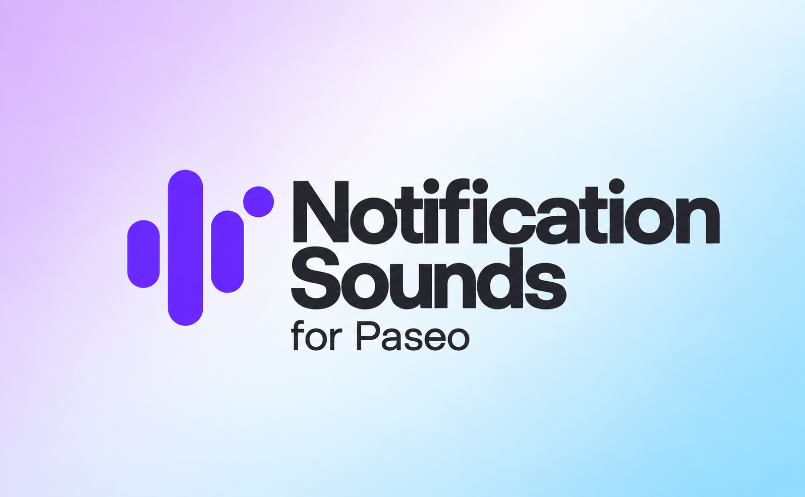
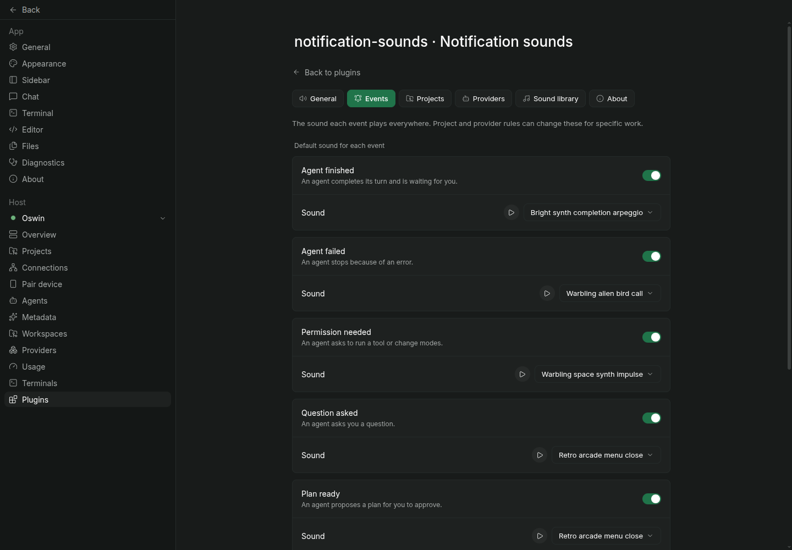
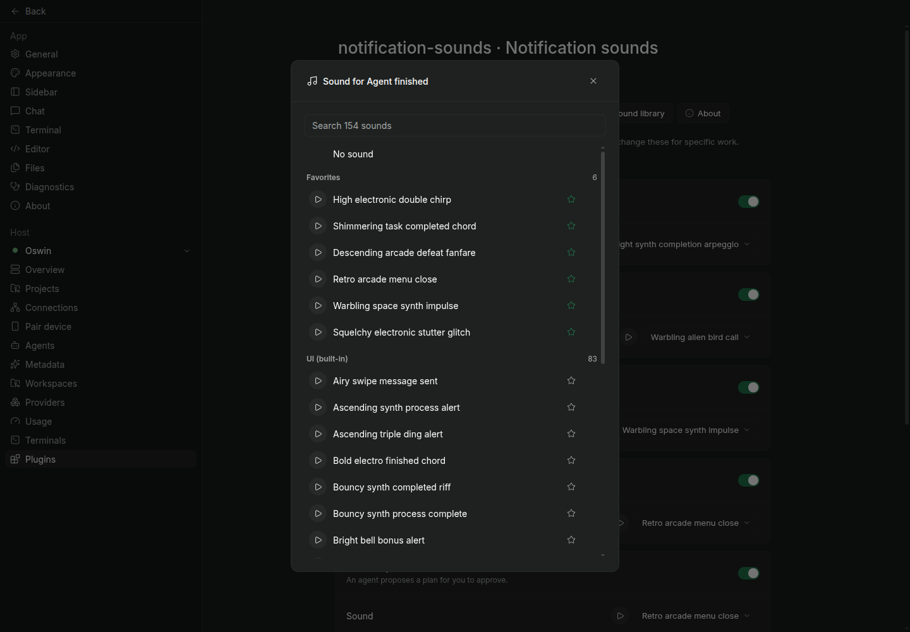
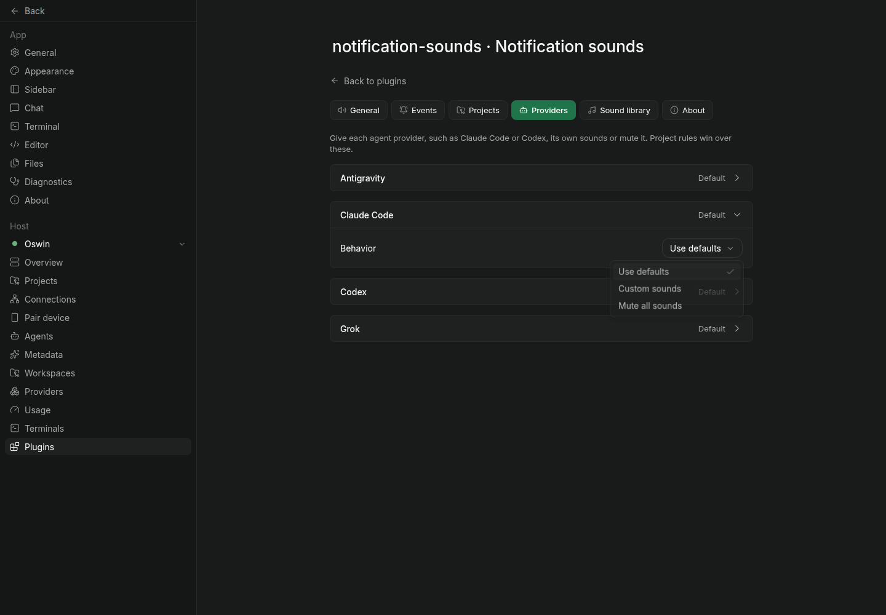
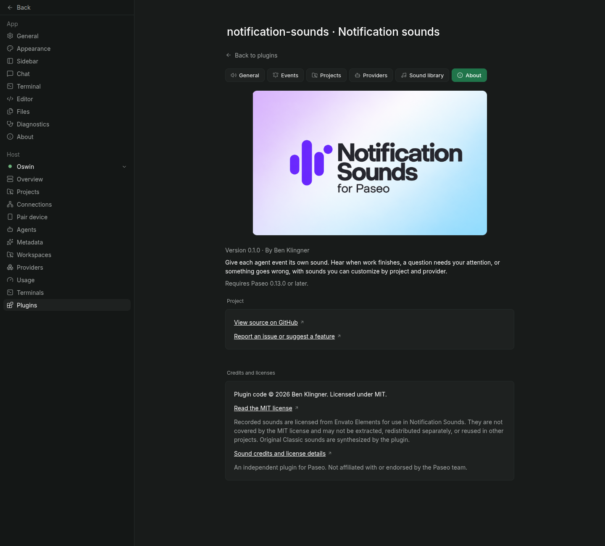

# Notification Sounds for Paseo

Play a different sound when an agent finishes, fails, asks a question, or needs permission.
Set sounds by event, project, and provider, preview them before choosing, and add your own audio files.

Requires **Paseo 0.13.0 or later**. Created by **Ben Klingner**.

## Install

With plugins enabled in Paseo, run:

```sh
paseo plugin add git:BenKlingner/notification-sounds
```

Plugins run as trusted code on your Paseo host and inside the app. Review the source before installing.
Open **Settings → Plugins → Notification sounds** to configure the plugin, or use
**Notification sounds: settings** in the Command Center.

## Features

- Choose from 141 recorded sounds, 13 synthesized Classic sounds, or your own audio files.
- Preview sounds, save favorites, and search the sound picker.
- Set defaults by event, then override or mute individual projects and providers.
- Adjust volume, repeat limits, and whether subagents play notifications.
- Optionally pause and resume media on Linux and Windows, or Apple Music and Spotify on macOS.
- Use desktop and compact layouts, with colors that follow your Paseo theme.

Sounds play on connected clients while Paseo is open. Settings are shared by clients connected
to the same host. Custom files stay on that host and are sent to connected clients for playback.
See [the overview](OVERVIEW.md) for supported formats, behavior, and limitations, and
[the security notes](SECURITY.md) for filesystem and media-control boundaries.

## Screenshots

### Event sounds



### Sound picker



### Provider rules



### About



## Development

```sh
npm ci --ignore-scripts
npm run typecheck
npm test
```

After changing package metadata or the approved logo, run `npm run generate:about` and commit
the updated `client/about-data.ts`. It embeds the About image so it works offline.
The recorded-sound module is already generated and committed; rebuilding it requires the
author's separately licensed source library and FFmpeg.

For media-control changes, run `npm test` on each target OS. The native helper discovery test
runs on Windows/macOS without changing playback. Then enable media pausing and verify a
playing supported app pauses and resumes around a preview, an already-paused app stays
paused, overlapping notifications share a pause, and unloading the plugin resumes media.
On macOS, also check denied Automation permission and that closed apps remain closed.
On Windows, check a player with Windows media controls and a browser with multiple sessions.
Native Windows/macOS playback has not yet been verified from this Linux development host.

For local testing, install the checkout and reload the plugin after source edits:

```sh
paseo plugin install /absolute/path/to/notification-sounds
paseo plugin reload notification-sounds
```

## Support

[Report a bug or suggest a feature](https://github.com/BenKlingner/notification-sounds/issues).
For bugs, include your Paseo version, operating system, and steps to reproduce.

## License and credits

The plugin code is licensed under [MIT](LICENSE).

**The recorded sound effects are not MIT-licensed.** They are licensed from Envato Elements
for use in Notification Sounds. They may not be extracted, redistributed separately, or reused
in another project. [Sound credits and license details](SOUND-LICENSES.md) list each item and author.
The Classic sounds are synthesized by the plugin.

Notification Sounds is an independent plugin and is not affiliated with or endorsed by the Paseo team.
